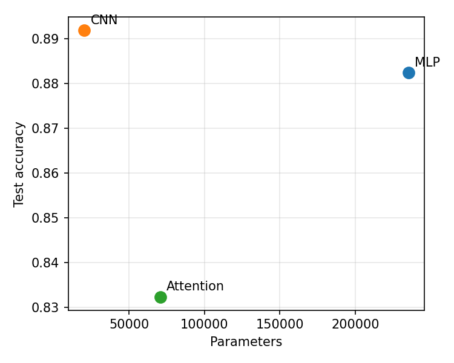
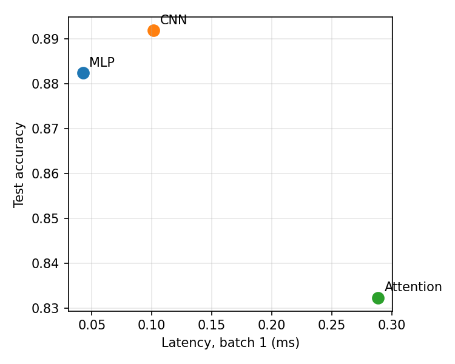

# Lab 3: Architectures and their costs

## 1. Setup
Fashion-MNIST, Normalize((0.2860,), (0.3530,)), 55k/5k/10k split (seed 0), batch 128, Adam lr 1e-3, 5 epochs.
Hardware: <CPU/GPU model>. PyTorch <version>. Latency: eval mode, no_grad, 10 warm-up runs, median of 100 (batch 1) / 20 (batch 128).

## 2. Parameter counts (hand-checked)
| Model | Hand count | torchinfo | Note |
|---|---|---|---|
| MLP | 200,960 + 32,896 + 1,290 = **235,146** | <fill> | |
| CNN | 160 + 4,640 + 15,690 = **20,490** | <fill> | |
| Attention | 3,200 + 2 x 33,472 + 650 = **70,794** | <fill> | no positional embedding |

Per encoder layer: in_proj 12,480 + out_proj 4,160 + FFN 8,320 + 8,256 + 2 LayerNorms 256 = 33,472.

**Note:** the specified architectures do not fall in the 100k-150k target (MLP is above it, CNN and Attention below). I implemented the architectures exactly as specified and report the actual counts; accuracy comparisons are therefore not strictly iso-parameter.

## 3. FLOPs: hand vs measured (per sample, 1 MAC = 2 FLOPs)
| Layer | Hand formula | Hand FLOPs | thop (x2 MACs) |
|---|---|---|---|
| MLP Linear 784->256 | 2 x 784 x 256 | 401,408 | <401,408> |
| CNN Conv2d 16->32, 14x14 out | 2 x 3 x 3 x 16 x 32 x 14 x 14 | 1,806,336 | <1,806,336> |
| Attn QKV proj | 2 x 16 x 64 x 192 | 393,216 | |
| Attn scores QK^T | 2 x 16^2 x 64 | 32,768 | |
| Attn weights x V | 2 x 16^2 x 64 | 32,768 | |
| Attn output proj | 2 x 16 x 64 x 64 | 131,072 | |
| Attn FFN (64->128->64) | 2 x (2 x 16 x 64 x 128) | 524,288 | |
| **Attn layer total** | | **1,114,112** | <1,114,112> |

(CNN conv1: 2 x 9 x 1 x 16 x 28 x 28 = 225,792.)

**Explaining the gap** (adapt to your numbers):
- thop reports **MACs**, not FLOPs; multiply by 2 to compare.
- thop only counts registered module types (Linear, Conv2d, ...). The QK^T and attention x V matmuls inside `nn.MultiheadAttention` are functional ops and are typically **not counted**, and softmax, LayerNorm, ReLU, pooling and mean-pool are ignored or counted as negligible. So thop undercounts the Attention model most.
- Hand calculation ignores biases and element-wise ops too.

## 4. Latency and accuracy
| Model | Params | FLOPs (thop) | Lat. b=1 (ms) | Lat. b=128 (ms) | Val acc | Test acc |
|---|---|---|---|---|---|---|
| MLP | | | | | | |
| CNN | | | | | | |
| Attention | | | | | | |

 

## 5. Cost-effectiveness discussion (Ch. 4.6-4.7)
Points to cover, backed by your numbers:
- **MLP:** dense matmul, every weight used once per sample (no reuse) -> memory-bound at batch 1; most parameters (200k) but flat access pattern, very GPU/CPU friendly at large batch.
- **CNN:** weight sharing and local receptive fields give high reuse and few parameters (20k) but many FLOPs per parameter; sliding-window access, benefits from locality/tiling; small channel counts may underutilize hardware.
- **Attention:** O(seq^2) score matrix, data-dependent access, softmax and LayerNorm are memory-bound element-wise ops, many small kernels -> launch overhead dominates at batch 1 on this tiny model; flexible but costlier per accuracy here.
- Conclude which sits best on the accuracy-vs-latency/params frontier, and whether batch 1 vs 128 changes the ranking (arithmetic intensity, kernel-launch overhead, batching amortizing weight loads).

## 6. Reproducibility
From the repo root: `python lab03/src/lab3.py` produces `lab03/results/results.json` and both plots.
